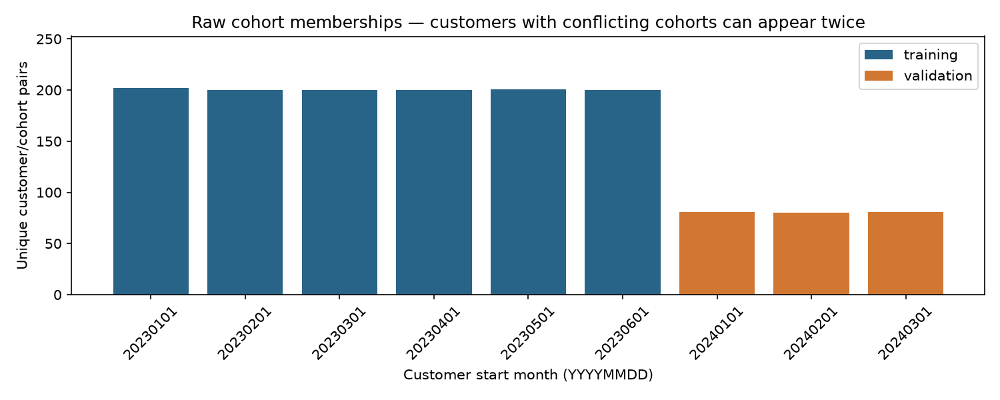
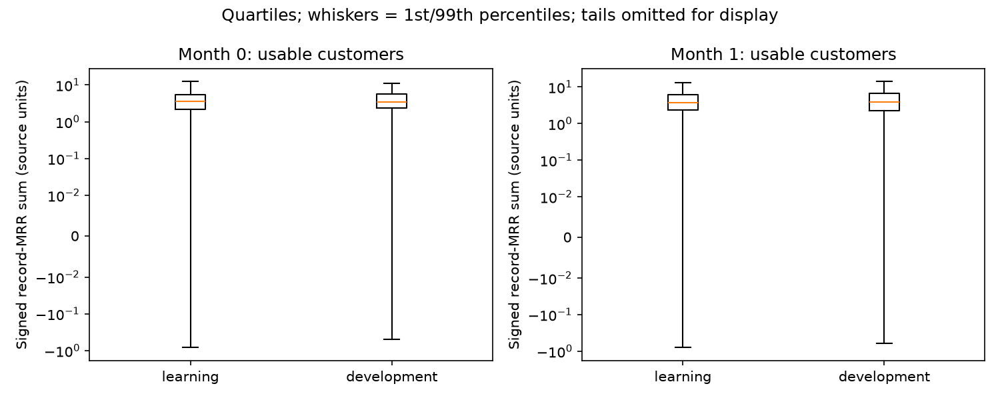
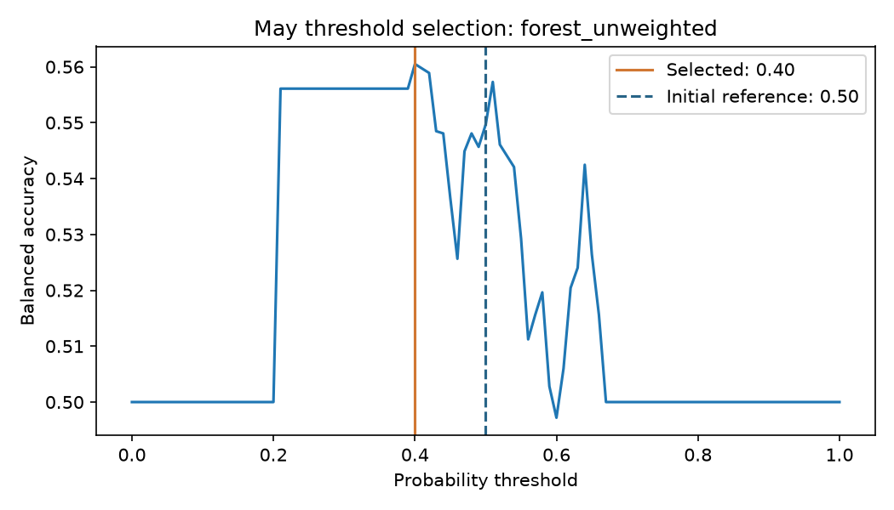
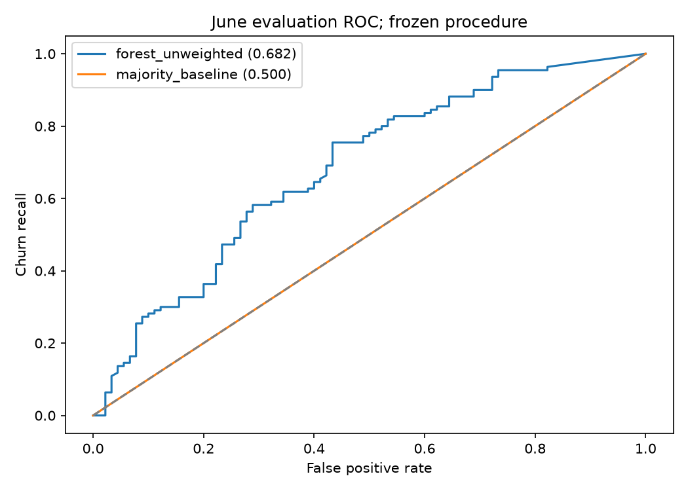
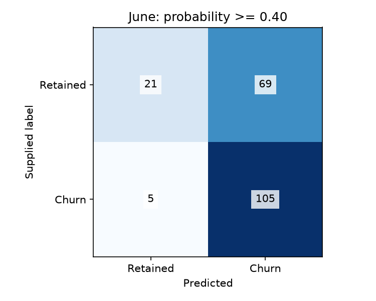

# Synthetic demonstration results

This is a curated snapshot of the default seed-42 fictional demonstration.
It contains five aggregate figures, a machine-readable [summary](summary.json),
and an [executed notebook](customer_churn_demo.ipynb) with visible tables and
embedded figures. There are no customer-level tables, prediction files or models.
Historical private assessment metrics are documented separately.

The executed notebook is a reading snapshot. To run the workflow, use
[`notebooks/customer_churn_demo.ipynb`](../../notebooks/customer_churn_demo.ipynb)
from the repository root or `notebooks/`. Follow the root README's reproduction
commands, then run `python -m src.export_demo_results`. The exporter requires the
default synthetic inputs and current manifest hashes; rerun the whole notebook
after changing a recorded source or documentation file. Do not edit PNGs or the
executed snapshot manually. Execution timestamps are removed from the snapshot.

## 1. Cohort coverage

Acquisition months define chronological learning, development and assessment
roles. Coverage alone does not establish annual seasonality.

## 2. Signed amount distributions

Quantiles reveal scale and signed values in the learning and development data.
Invoice-record amounts are not a verified revenue KPI.

## 3. May threshold selection

The fixed grid selects a cutoff using balanced accuracy before assessing June.
A cutoff is an explicit decision rule, not a calibrated probability guarantee.

## 4. June discrimination

The frozen procedure is compared with the majority reference on the complete
eligible assessment population, including customers requiring fallback.

## 5. June classification errors

Read true and false positives together with retained-customer recall: high churn
recall can require flagging many retained customers. Business costs and causal
retention benefit are not measured by this fictional demonstration.
